# How the Travel Planner works, in flows

Twelve diagrams, each answering one question someone asks about this demo. They're drawn
from the Python worker (the reference implementation); see [`CONTRACT.md`](../CONTRACT.md)
for what every SDK's worker implements.

| # | Question | Flow |
|---|---|---|
| 1 | What are the moving parts? | [Architecture](#1-architecture) |
| 2 | What happens when I send a message? | [One chat turn](#2-one-chat-turn) |
| 3 | What is "the agent"? | [The agent loop](#3-the-agent-loop) |
| 4 | How does research run in parallel? | [Research fan-out](#4-research-fan-out) |
| 5 | What if the worker crashes? | [Crash recovery](#5-crash-recovery) |
| 6 | How does a human approve a booking? | [Human in the loop](#6-human-in-the-loop) |
| 7 | How does the agent hand off to a business process? | [Agent to checkout](#7-agent-to-checkout) |
| 8 | What happens when a booking step fails? | [The checkout saga](#8-the-checkout-saga) |
| 9 | When does the saga undo a step? | [Compensation rules](#9-compensation-rules) |
| 10 | What if the LLM provider goes down? | [Failure handling](#10-failure-handling) |
| 11 | How do retries avoid double-booking? | [Idempotency keys](#11-idempotency-keys) |
| 12 | How long does a conversation live? | [Conversation lifecycle](#12-conversation-lifecycle) |

## 1. Architecture

The gateway holds no state and imports no worker code. It drives the workflow by name
over the Temporal client. Everything durable lives in Temporal (the conversation,
the itinerary) or Postgres (the catalog, bookings, invoices).

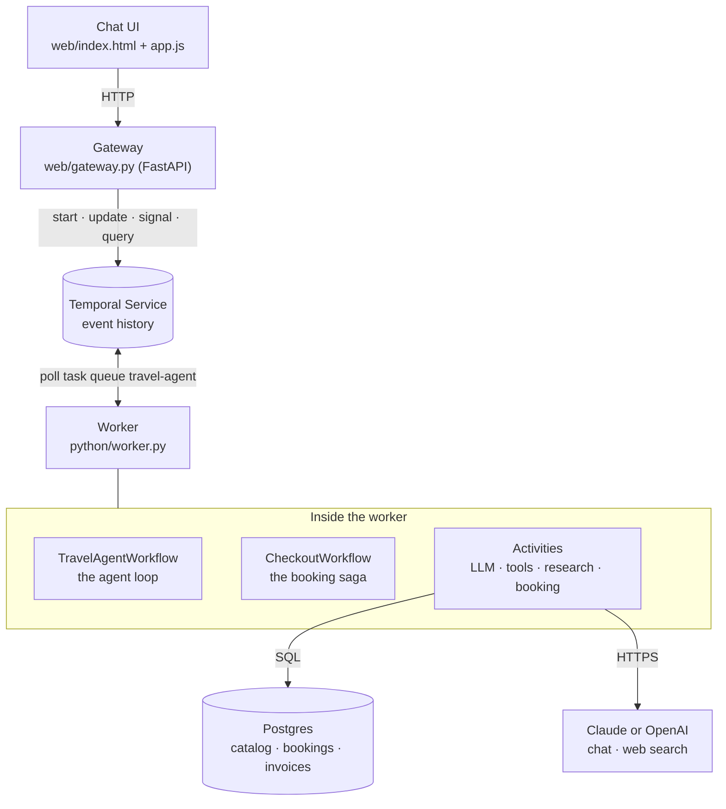

## 2. One chat turn

A message is a Temporal **Update**: it goes in and the reply comes back on the same call.
The workflow keeps the conversation in its own state, so there's no session store.

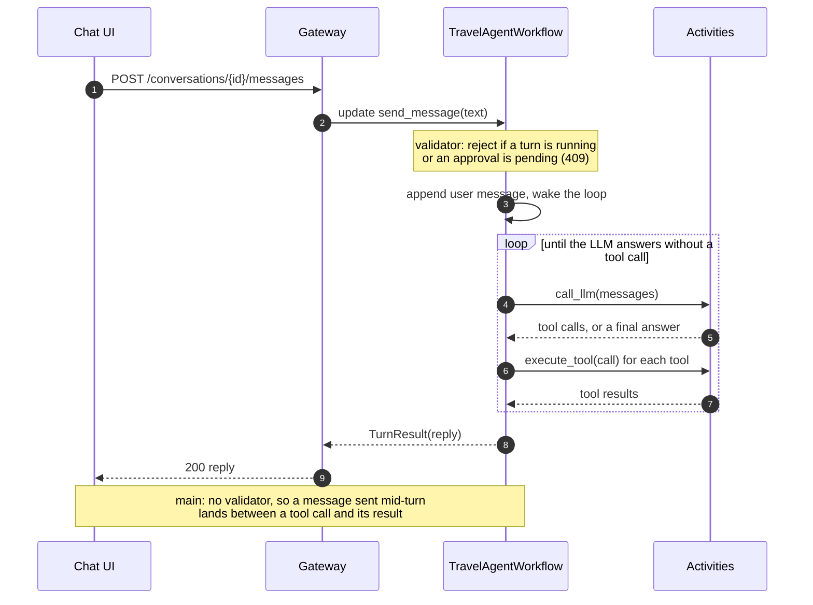

## 3. The agent loop

`agent.py` is one `while` loop with numbered steps. Tools are dispatched by behaviour, so
adding a tool doesn't change the loop.

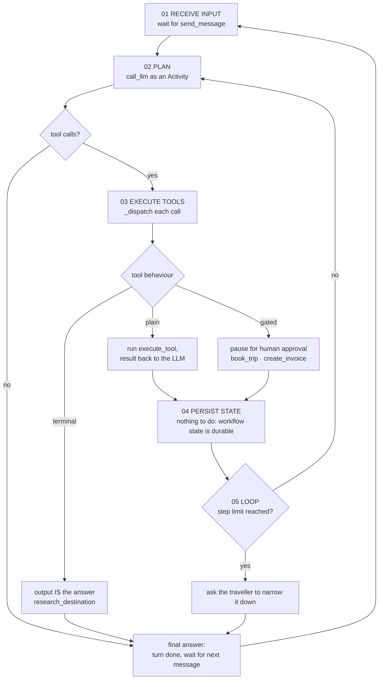

Branch only: the step limit (12 tool rounds per turn). On `main` the inner loop is unbounded.

## 4. Research fan-out

`research_destination` plans N searches, runs them as **parallel Activities**, then writes a
cited guide. The UI polls a query to draw the progress card.

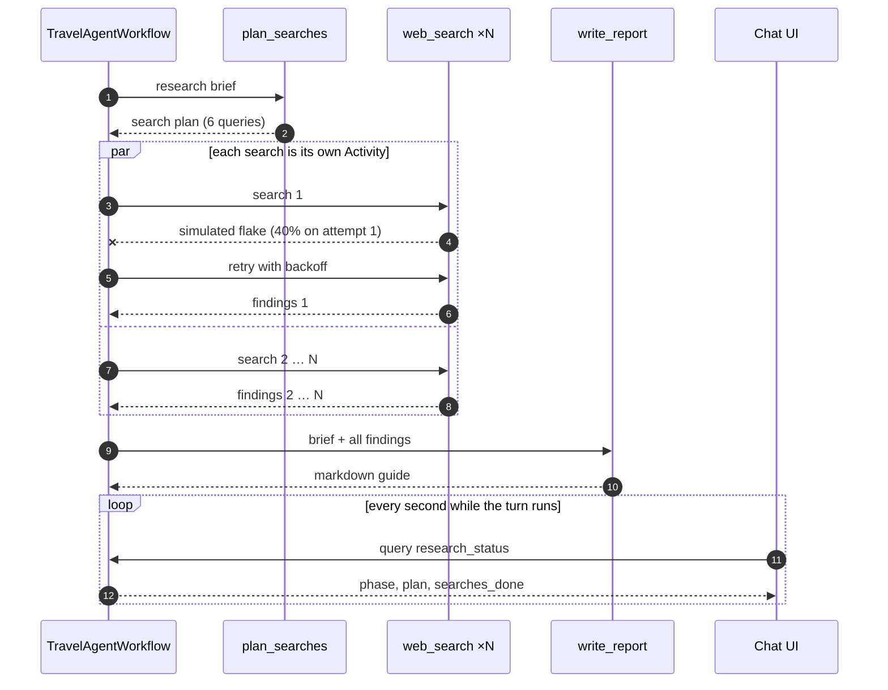

## 5. Crash recovery

The workflow's progress is its event history on the Temporal Service, not the worker's
memory. A new worker replays the history and carries on from the next step.

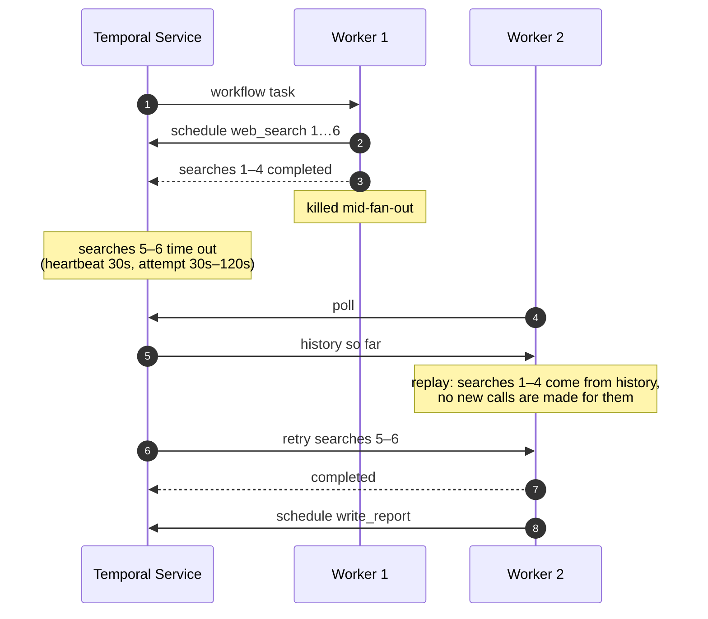

## 6. Human in the loop

A gated tool parks the turn on a **durable wait**. It costs nothing while it waits and it
survives restarts. The Update returns early so the UI can show the approval card; the
approval itself arrives as a **Signal**.

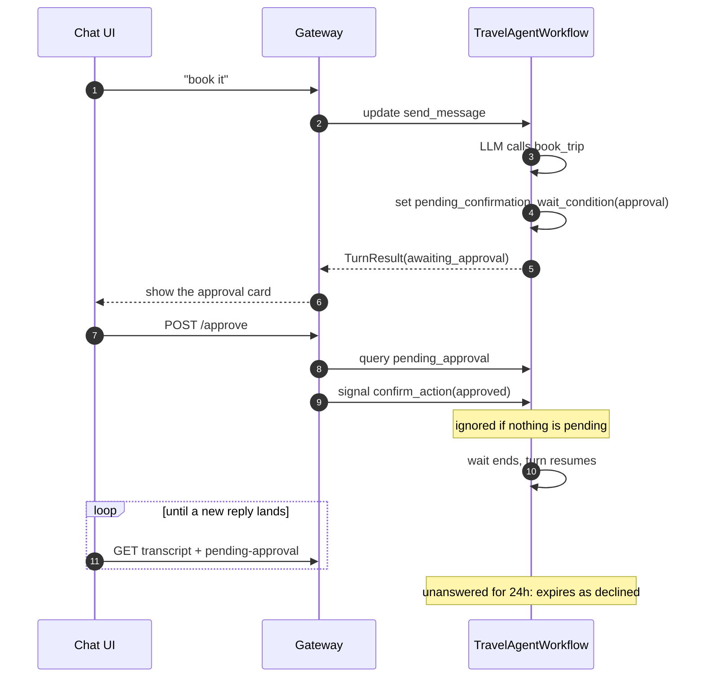

Branch only: the guarded signal and the 24-hour expiry. On `main` a stray `confirm_action`
stays in state and approves the next gated action.

## 7. Agent to checkout

The agent decides **what** to book. A child workflow owns **how**: ordering, retries and
compensation. The child's result goes back to the LLM as an ordinary tool result.

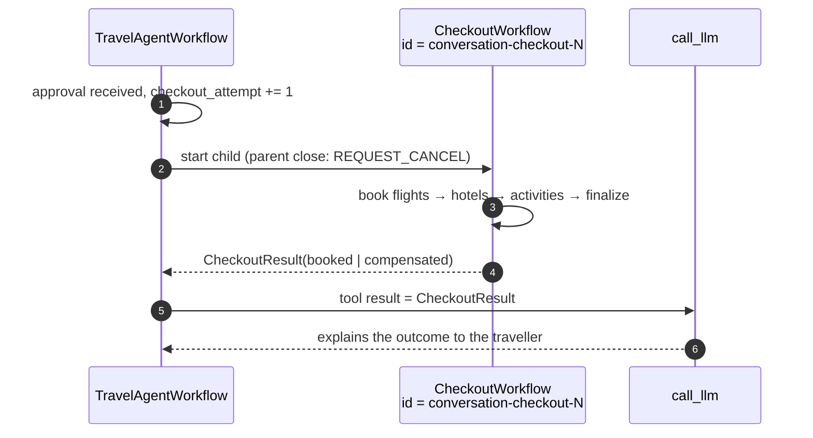

## 8. The checkout saga

The scripted demo path: the first attempt's hotel declines, so the flight is cancelled.
A second attempt books cleanly.

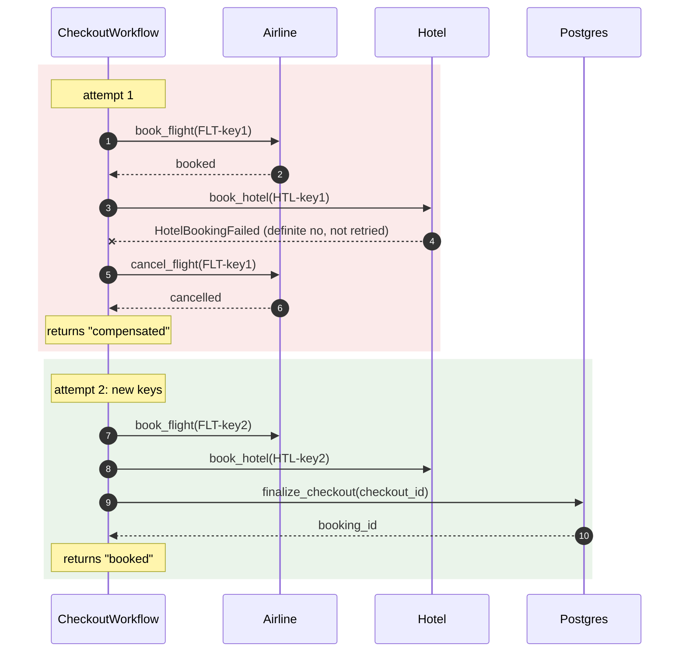

## 9. Compensation rules

What the saga does when a step fails. A **definite no** left nothing behind. An **unknown
outcome** (timed out, retries exhausted, cancelled mid-step) might have booked, and
cancelling by ID is safe either way, so it gets undone too.

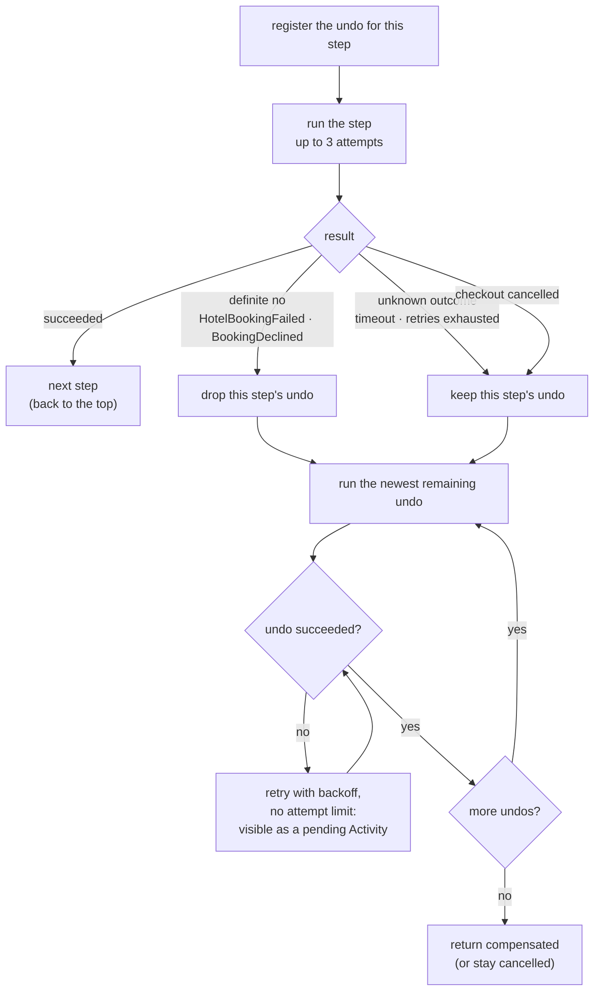

Branch only. On `main`: undos are registered after the step succeeds, so an unknown outcome
isn't undone; undos stop after 3 attempts; cancellation doesn't compensate.

## 10. Failure handling

Three layers. Classify what you know, retry what's transient, and bound what you don't know.
The Demo-controls LLM kill switch exercises the second layer.

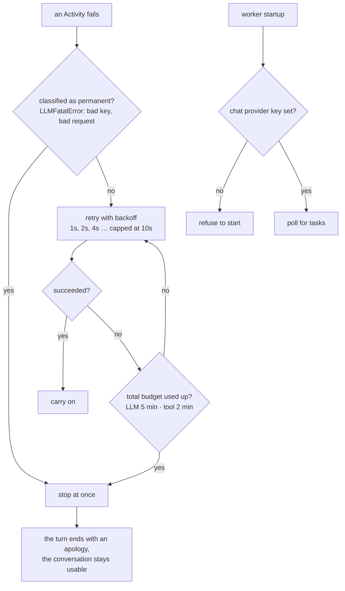

Branch only: the budgets and the startup check. On `main` an unclassified error (such as a
missing key) retries forever.

## 11. Idempotency keys

Every key is derived from the workflow ID, so a replay or a retry produces the same key, and
the receiving system recognises the repeat.

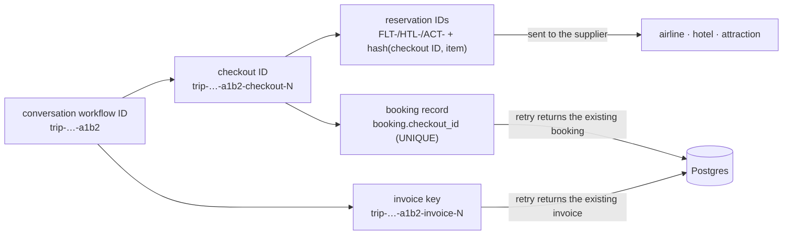

Branch only. On `main`: reservation IDs hash the conversation (not the checkout), so a second
attempt reuses a cancelled reservation's ID; bookings and invoices have no key, and a
retried finalize can decline its own booking as a duplicate.

## 12. Conversation lifecycle

One conversation is one workflow ID. Its history is kept short by continuing-as-new between
turns, and it closes itself once idle.

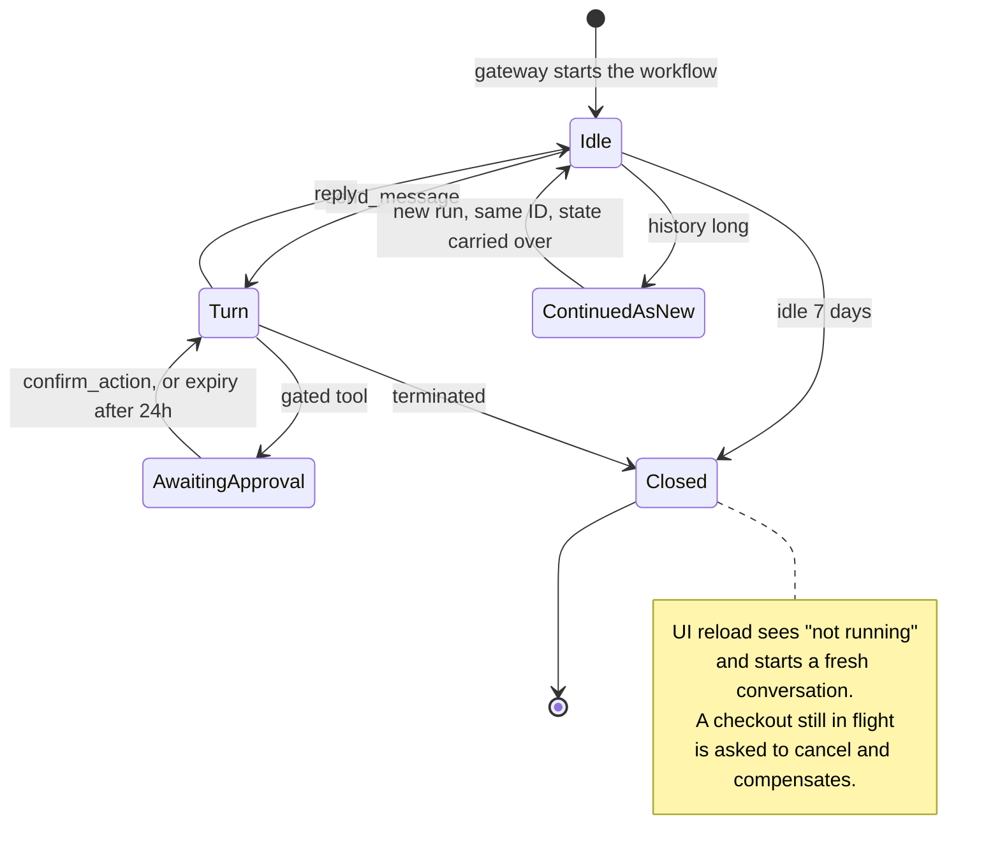

Branch only: continue-as-new, idle close and approval expiry. On `main` a conversation runs
until it's terminated, and its history grows with every turn.
